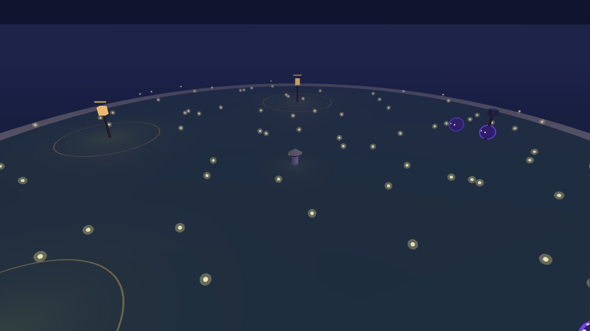

# Đảo Đèn Lồng

> **Video demo:** _(chưa có — sẽ thêm khi quay xong, mục Phase 4)_
> Day 12 AI SDLC · Nguyễn Đức Huân · 2A202603690. Đề bài: [lab board](https://claude.ai/artifact/Q1RYyv1dxjUczzCbd2ZnoW) · spec: [PRD-0](docs/lab/PRD-0.md), [TICKET-02](docs/lab/TICKET-02.md), [TICKET-03](docs/lab/TICKET-03.md), TICKET-04.

Game 3D góc nhìn thứ ba. Mây, người giữ đèn nhỏ tuổi, gom đom đóm để thắp lại các Đèn Lồng Lớn trên **ba hòn đảo** (Đảo Bến, Đảo Cau, Đảo Chuông), giữ đèn sáng tới bình minh, và né Bóng Mực cùng Gió Lạc trong sương đen.



## Yêu cầu hệ thống
- Node.js ≥ 20 (đã kiểm với Node 24; CI chạy Node 22).
- Windows, macOS hoặc Linux. Trình duyệt Chrome hoặc Edge để chạy benchmark.
- Không cần GPU rời; game chạy bằng WebGL.

## Cài và chạy
```powershell
npm ci
npm run build
npm start          # mở http://localhost:5173
```

`npm start` phục vụ bản web và API bảng xếp hạng cục bộ cùng một cổng.

## Điều khiển
Mặc định; có thể đổi trong **Cài đặt → Phím điều khiển**. Đổi phím báo trùng phím, có nút "Khôi phục mặc định".

| Phím | Hành động |
|---|---|
| W A S D | Đi (có thể đổi) |
| Space | Nhảy (chỉ khi chạm đất) |
| Shift trái | Lướt (14 m/s trong 0,2 s, hồi 1,5 s) |
| E | Nạp ánh sáng vào đèn gần nhất chưa sáng (trong 2 m) |
| F | Tỏa Sáng (tốn 3 đom đóm, hồi 3 s) |
| P | Tạm dừng (có thể đổi). Esc luôn tạm dừng và cũng dùng để quay lại |
| ← / → hoặc kéo chuột | Xoay camera (cố định; độ nhạy chỉnh trong Cài đặt) |
| F3 | Hiện/ẩn FPS |

## Trợ năng
- **Đổi phím:** 9 hành động (đi 4 hướng, nhảy, lướt, nạp, tỏa sáng, tạm dừng). Esc và phím mũi tên không gán được.
- **Chỉ báo hình ảnh:** Bóng Mực xuất hiện (chữ + mũi tên chỉ ở mép màn hình), gió sắp thổi (chữ + âm thanh), 10 giây cuối, đèn sắp tắt (dưới 30 dầu, nhấp nháy và có dòng chữ).
- **Giảm chuyển động:** tắt rung khung hình khi trúng đòn và chớp màn hình khi Tỏa Sáng.
- **Chữ lớn:** phóng giao diện ×1,25. Chữ giao diện tối thiểu 18 px ở 1280×720.
- **Bảng màu dễ phân biệt:** viền và mắt Bóng Mực xanh #00B3FF, cảnh báo trắng có ⚠.

Mọi cài đặt được lưu trên trình duyệt; nếu trình duyệt chặn lưu trữ, game vẫn chạy với mặc định.

## Luật chơi
- **Ba Đêm:** Đêm 1 Đảo Bến (240 s, 5 đèn), Đêm 2 Đảo Cau (270 s, 6 đèn, cầu tre và bục nhảy), Đêm 3 Đảo Chuông (300 s, 7 đèn, ba tầng, tháp chuông, gió mạnh). Mỗi Đêm Mây có 3 Ngọn Lửa.
- **Đom đóm:** nhặt tự động trong 1 m. Sức chứa là 10 + 2 × số lần thắp thành công, tối đa 20.
- **Đèn và dầu:** thắp lần đầu cần 10 đom đóm, thắp lại cần 5. Đèn sáng hao 1 dầu/s; châm 10 dầu cho mỗi đom đóm (tối đa 100). Về 0 dầu thì tắt. Dưới 30 dầu thì đèn nhấp nháy và mất vùng an toàn.
- **Bóng Mực:** đuổi khi Mây trong 12 m, bỏ đuổi sau 18 m, 4 m/s (Đêm 3: 4,5). Bóng lang thang tới đèn sáng dưới 30 dầu gần nhất và hút 5 dầu/s khi ở trong 2 m. Chạm Mây: −1 Ngọn Lửa, rơi một nửa đom đóm, bất tử 1,5 s.
- **Tỏa Sáng:** Bóng trong 5 m (tính 3D) choáng 2 s và bị đẩy lùi 4 m.
- **Gió Lạc** (Đêm 2, 3), **Bùa Gió**, **bục nhảy**, **gió mạnh** (Đêm 3): xem TICKET-02.
- **Thắng/thua:** hết lửa là thua ngay. Khi hết giờ (bình minh), thắng nếu còn ít nhất ceil(0,6 × tổng đèn) đèn sáng. Thắng Đêm 3 hoặc thua bất kỳ Đêm nào thì được lưu tên vào bảng xếp hạng.
- **Điểm:** nạp hoặc châm 1 đom đóm +5; thắp lần đầu +100; thắp lại +40; Bóng Mực trúng Tỏa Sáng +5 (+15 nếu đang hút); bình minh (chỉ khi thắng): mỗi đèn sáng +50 + dầu còn lại, mỗi Ngọn Lửa còn lại +50. Số lấy từ `game.contract.json`.

## Bảng xếp hạng
Menu → **Bảng xếp hạng**: top 10, sắp theo điểm giảm dần; bằng điểm thì ai đạt trước đứng trên. Tên 3–12 ký tự `[A-Za-z0-9_]`. Mỗi mục có tên, điểm (tổng các Đêm đã thắng), số Đêm thắng, thời điểm đạt (ISO 8601), và seed của ván.

Dữ liệu nằm ở `data/leaderboard.json` (không commit). Xuất ra file:
```powershell
npm start -- --export-leaderboard out.json
```
Ghi `{"entries": [ ... ]}` đúng thứ tự, rồi thoát với mã 0. Đường dẫn file có thể đổi bằng biến môi trường `DDL_LEADERBOARD`.

## Kiểm thử
```powershell
npm test                          # 171 test: bản đồ, di chuyển, đồ vật, kẻ địch, đèn/dầu, bảng xếp hạng, trợ năng, bench, contract
node scripts/proof.mjs --check    # 33 scenario headless, mỗi cái chạy 2 lần
```
CI (`.github/workflows/ci.yml`) chạy build, test và kiểm chứng trên Ubuntu và macOS mỗi lần push.

## Headless (Test Contract v1.3)
```powershell
node dist/headless/cli.js --seed 1 --night 2 --ticks 600 --out out/run.jsonl [--scenario f] [--inputs f]
```
Mã thoát: 0 thành công · 2 file inputs/scenario sai định dạng · 1 sai tham số. Chi tiết trong [ADR-001](docs/notes/adr-001-lantern-fuel.md), [changelog Phase 3](docs/notes/changelog-phase3.md) và [giả định](docs/notes/assumptions.md).

## Benchmark (TICKET-04)
```powershell
npm run build
node scripts/bench.mjs --seed 42 --duration 30 --out docs/proof/phase-4/bench.json
```
Mở Chrome hoặc Edge đã cài, khung nhìn 1280×720, cảnh cố định ở `?bench=1`: Đêm 1, 200 Bóng Mực wander rải theo seed 42, 100 đom đóm, đèn L1–L3 sáng fuel 100, không có input, Mây đứng yên ở (0,0,0), camera bay vòng tròn bán kính 30 m, cao 15 m, 15 s một vòng. Trong cảnh này tắt: sinh thực thể, sát thương, nhặt đom đóm, hao dầu, kết thúc Đêm, và đuổi (Bóng Mực vẫn wander). Ba giây đầu là khởi động; sau đó đo đúng `--duration` giây.

Kết quả đo trên máy phát triển (không phải máy chấm của giảng viên), xem [docs/proof/phase-4/](docs/proof/phase-4/README.md):

| Chỉ số | Kết quả | Ngưỡng |
|---|---|---|
| avg_fps | 222.3 | ≥ 60 |
| p1_low_fps | 128.6 | ≥ 30 |
| load_ms | 1390 | ≤ 10000 |
| frame_ms_p95 | 6.2 | — |
| peak_mem_mb | 1052.1 | — |

Ghi chú về phép đo:
- `vsync_off` là `false`: script yêu cầu tắt vsync bằng cờ Chrome, nhưng không xác minh được cờ đã có hiệu lực, nên không ghi là đã tắt.
- `peak_mem_mb` là working set của cây tiến trình trình duyệt, lấy mẫu mỗi giây; đỉnh ngắn hơn một giây có thể bị bỏ sót.
- Số đo trên máy chấm sẽ khác. Giảng viên công bố cấu hình trước khi đo.

## Soak test (TICKET-04)
```powershell
node dist/headless/soak.js --seed 7 --nights 10 --out soak.json
```
Chạy 10 Đêm liên tiếp trong một tiến trình (1 → 2 → 3 → 1 …), Đêm i dùng seed 7 + i, input ngẫu nhiên theo seed (đổi hướng mỗi 30 tick; mỗi tick: nhảy 5%, lướt 3%, tỏa sáng 2%, tương tác 10%). Kết quả lần chạy chính thức: **0 crash**, nhưng **không đạt ngưỡng bộ nhớ**: `mem_start_mb` 37.2, `mem_end_mb` 49.1 (1.32×; ngưỡng ≤ 1.2×). Heap JS đo sau GC ổn định ở khoảng 5.5 MB qua nhiều vòng, nên phần tăng là RSS khởi động của V8 (JIT, cấp phát), không phải rò rỉ JS. Chi tiết trong [docs/proof/phase-4/](docs/proof/phase-4/README.md). Tất cả 10 Đêm trong lần chạy này đều thua.

## Cấu trúc
| Đường dẫn | Nội dung |
|---|---|
| `src/core/` | Toàn bộ luật game, bản đồ, bảng xếp hạng (thuần TypeScript, dùng chung cho game và headless) |
| `src/headless/` | CLI theo Test Contract, xuất bảng xếp hạng, soak test, lưu bảng xếp hạng |
| `src/client/` | Hiển thị Three.js, giao diện, trợ năng, âm thanh, cài đặt, bảng xếp hạng |
| `scripts/` | `serve.mjs` (`npm start`), `bench.mjs` (benchmark), `proof.mjs` (bằng chứng), hook Stop |
| `tests/`, `scenarios/` | Test và scenario headless |
| `docs/notes/` | Giả định, ADR, changelog, tiêu chí nghiệm thu, nhật ký AI, retro |
| `docs/proof/` | Bằng chứng từng phase, bench và soak của Phase 4 |
| `CHANGELOG.md` | Lịch sử thay đổi cho cả 4 phase |
| `AGENTS.md`, `CLAUDE.md`, `.claude/` | Harness AI: hướng dẫn agent, skill `run-proof` và `verify-client`, hook Stop chặn khi test đỏ |

## Quyết định thiết kế
- Phase 3 đổi luật thắng và mô hình đèn: [ADR-001](docs/notes/adr-001-lantern-fuel.md).
- Phase 4 đổi bảng xếp hạng thành dịch vụ cục bộ (`npm start`) thay vì chỉ `localStorage`, để `--export-leaderboard` đọc được cùng dữ liệu với game.

## Chưa đạt hoặc chưa kiểm chứng
- **Soak test không đạt ngưỡng bộ nhớ** (1.32× so với 1.2×). Xem mục Soak test.
- **Bench trên máy chấm chưa đo;** `vsync_off` chưa xác minh.
- Âm thanh chưa được nghe thử (môi trường kiểm tra không có loa). Màu pixel chưa đo bằng mắt, và chưa chơi tay một ván đủ cả ba Đêm.
- Video demo chưa quay.
- Chi tiết các mục Phase 2–3 trong [bằng chứng Phase 2](docs/proof/phase-2/README.md) và [bằng chứng Phase 3](docs/proof/phase-3/README.md).

## Cấp phép và ghi nguồn
Mã nguồn theo [MIT](LICENSE). Thư viện, asset và công cụ AI: [CREDITS.md](CREDITS.md).
